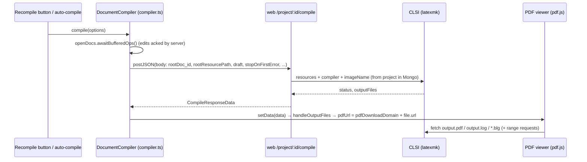
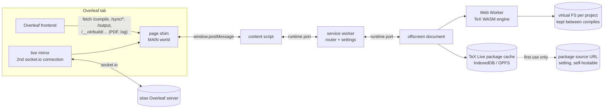

# LocaLeaf: plan

Goal: while the Overleaf editor is open in Chrome or Brave (on a slow self-hosted server), clicking
**Recompile** (or an auto-compile) compiles the project **on this machine**. Preferably that happens
inside the browser extension itself, with no install beyond the extension. The PDF, logs, error
annotations and SyncTeX in Overleaf's own preview pane come from that local build, and every compile
setting (main document, compiler, draft, stop on first error, auto-compile) still applies.

Status: planning only. Research is based on `overleaf/overleaf@e039ad2` (2026-09-17).

**Direction (2026-11-22):** extension-only, with TeX running as **WebAssembly** inside the extension.
A native `latexmk` backend is an optional add-on behind the same interface, used only if WASM turns
out too slow or too limited.

---

## 1. Does this exist already? Yes, mostly

> [!IMPORTANT]
> **[Local Compile for Overleaf](https://github.com/DominikPeters/local-compile-for-overleaf)**
> by Dominik Peters (AGPL-3.0, Chrome extension + `pip install local-compile-for-overleaf`,
> v0.1.2, 2026-06-30, about 2 GitHub stars) does almost exactly this, and it supports
> self-hosted Community Edition instances ("Enable on this instance" in the popup).

What I read in its source:

| Aspect | How it does it |
|---|---|
| Hook | MAIN-world `page-shim.ts` patches `window.fetch` + `XMLHttpRequest`; catches `POST /project/:id/compile` and `/compile/stop` |
| Local process | Python native-messaging host → starts a `127.0.0.1` HTTP server with a bearer token |
| Project files | Per compile: `POST /project/:id/flush`, then `GET /project/:id/changes?since=v` (history-v1), docs/blobs via `/project/:id/blob/:hash`. Falls back to `/download/zip` |
| PDF display | Fake `CompileResponseData` with `pdfDownloadDomain` = local server, so Overleaf's own viewer loads the PDF |
| SyncTeX | Local `synctex view/edit` |
| Draft / stop-on-first-error / main doc | Yes (same flags as CLSI) |
| **Compiler setting** | **Appears not passed.** The browser's compile body has no `compiler`, and the host defaults to `pdflatex`, so XeLaTeX/LuaLaTeX projects would compile with the wrong engine (needs testing) |
| TeX Live version | Whatever is on `PATH` |

Other prior art. None of these replace the in-browser preview:

- [Overleaf-Workshop](https://github.com/iamhyc/overleaf-workshop) (VS Code): full socket.io client, local replica, local compile through LaTeX-Workshop. A useful reference for the real-time protocol.
- [LocalLeaf](https://github.com/Teddy-van-Jerry/LocalLeaf), [olcli](https://raw.githubusercontent.com/aloth/olcli/main/README.md), [overleaf-offline](https://github.com/gkilleen33/overleaf-offline), Canopy: sync tools or offline editors.
- [Overleave](https://github.com/mauroalejandrojm/overleave): opens the PDF in a new tab. Not a local compiler.


### Tried on Brave (2026-11-22): didn't work

What I found on this machine:

- `pip show local-compile-for-overleaf` finds nothing, so **the Python helper isn't installed**. Brave's
  `~/.config/BraveSoftware/Brave-Browser/NativeMessagingHosts/` only has `firenvim.json`. Without the helper,
  the extension has nothing to compile with, so the page doesn't change.
- Its installer *does* know Brave's Linux path (`install.py` → `BraveSoftware/Brave-Browser`), so
  `pipx install local-compile-for-overleaf && local-compile-for-overleaf install` would probably fix the
  connection. It also needs "Enable on this instance" in its popup for your self-hosted domain.
- The extension ID isn't in the `Default` profile's `Extensions/` folder right now (removed, or loaded unpacked?).
  So the missing popup can't be checked from here.
- Either way, it **requires** a local Python helper, which is what we want to avoid.

### Its other weak spot for *your* case (slow server)

It still makes **several server round trips per compile**: a history flush (which goes
document-updater → project-history → history-v1), a changes query and blob downloads. On a slow
server, the flush can cost seconds. The design below makes no server requests on the compile path.

### Prior art for TeX in the browser (needed for extension-only)

| | [texlyre-busytex](https://github.com/TeXlyre/texlyre-busytex) | [Siglum](https://github.com/SiglumProject/siglum) |
|---|---|---|
| License | AGPL-3.0 (base BusyTeX is MIT) | MIT |
| TeX Live | 2026 | 2026 |
| Engines | pdfLaTeX, XeLaTeX, LuaLaTeX | pdfLaTeX, XeLaTeX (**no LuaLaTeX**) |
| Bibliography | bibtex8, **biber (WASM)**, makeindex, a rerun option | BibTeX only (biblatex needs `backend=bibtex`) |
| SyncTeX | **yes** (`synctex` bytes in the result) | not documented |
| Packages | WASM ~32 MB + data bundles 90–400 MB (GitHub Releases), optional on-demand `remoteEndpoint` | small core + lazy per-package fetch via a proxy (self-hostable, Bun reference proxy) |
| Caching | Emscripten IndexedDB preload cache only | Cache Storage / OPFS, offline once cached |
| Runs in | Web Worker | Web Worker; SharedArrayBuffer optional |
| Limits | shell-escape only via JS handlers; fonts only from TeX Live | ~512 MB heap |

Neither publishes timings, and neither documents keeping `.aux` files between compiles. **Speed against
your server is the main unknown. Milestone 0 measures it before anything else is built.**

---

## 2. How Overleaf's compile path actually works (from the source)



Facts that make interception clean:

- **One request per compile.** `services/web/frontend/js/features/pdf-preview/util/compiler.ts`
  calls `postJSON('/project/:id/compile?auto_compile=…', body)` (plain `fetch`, see
  `infrastructure/fetch-json.ts`). Body: `rootDoc_id`, `rootResourcePath`, `draft`,
  `stopOnFirstError`, `incrementalCompilesEnabled`, `check`, `editorId`.
- **The compiler and TeX Live image are *not* in the body.** The server reads them from the project.
  We have to get them ourselves (the socket `joinProject` response has `project.compiler` and `project.imageName`).
- **The response is plain data** (`services/web/types/compile.ts → CompileResponseData`):
  `status`, `outputFiles[{path,url,type,build}]`, `pdfDownloadDomain`, `clsiServerId`, …
- **The URL indirection is built in:** `output-files.ts:buildURL` →
  `${pdfDownloadDomain}${file.url}` if `file.build && pdfDownloadDomain`. So the PDF, log and blg
  are fetched from wherever we point `pdfDownloadDomain`.
- The PDF is only shown when `status === 'success'` (`local-compile-context.tsx`). The log is parsed
  client-side (`HumanReadableLogs`), so errors and editor annotations work with *our* `output.log`.
- **Other endpoints to answer locally:** `POST …/compile/stop`, `DELETE …/output` (clear cache),
  `GET …/sync/code` → `{pdf:[{page,h,v,width,height}]}`, `GET …/sync/pdf` → `{code:[{file,line,column}]}`,
  and the download button (`fromCache: true` ⇒ `pdfDownloadUrl = file.downloadURL`).
- **CLSI command** (`services/clsi/app/js/LatexRunner.js`):
  `latexmk -cd -jobname=output -auxdir=D -outdir=D -synctex=1 -interaction=batchmode -time`
  `+ (-halt-on-error | -f) + {-pdf | -pdfdvi | -xelatex | -lualatex} D/<main>.tex`.
  Draft mode (`DraftModeManager.js`) prepends `\PassOptionsToPackage{draft}{graphicx}\PassOptionsToPackage{draft}{graphics}`
  to the main file.
- **CSP** for the editor view only restricts `script-src`/`object-src`/`base-uri`, and it is off by
  default in CE (`CSP_ENABLED`). The extension-only design never fetches from localhost (§4.4),
  so neither CSP nor Chrome's *Local Network Access* prompt gets in the way.

---

---

## 3. Approaches considered

| # | Approach | Verdict |
|---|---|---|
| A | Userscript (Tampermonkey/Violentmonkey) + WASM | Possible, but it has to run the engine in the page and cache packages per site. Fine for a throwaway spike, not for the final tool |
| **B** | **MV3 extension, TeX as WASM in an offscreen document** | **Chosen.** Nothing to install besides the extension, works in Chrome and Brave, and collaborators' TeX runs sandboxed |
| B′ | Same extension + optional native `latexmk` helper | Only if WASM is too slow or too limited. Same backend interface, plugs in later |
| C | Local app only (sync to folder + Zathura/Okular) | Doesn't replace the preview inside Overleaf. Rejected |
| E | Overlay our own pdf.js viewer over Overleaf's pane (DOM) | Loses log, annotation and SyncTeX integration, and the CSS breaks easily. Rejected |
| F | `declarativeNetRequest` redirect of `/compile` | Can't answer with locally made data. Rejected |

**Hook choice (unchanged):** patch `fetch`/`XMLHttpRequest` in the page (MAIN world, `document_start`)
and answer `/compile` with a synthetic `CompileResponseData`. Overleaf's own UI then does everything
else: PDF viewer, logs pane, error annotations, SyncTeX highlights, the download button.

---

## 4. Architecture (extension-only)



### 4.1 Backend interface (so native can be added later without touching the rest)

```ts
interface CompileBackend {
  sync(projectId, changes: FileChange[]): Promise<void>       // keep its own copy current
  compile(projectId, opts: CompileOpts): Promise<BuildResult>  // {status, files: Map<path, bytes>, log}
  stop(projectId): Promise<void>
  clear(projectId): Promise<void>
  capabilities(): { engines, biber, shellEscape, ... }         // read, never assumed
}
```

Implementations: `WasmBackend` (default), `ServerBackend` (passes the request through to Overleaf unchanged),
and later maybe `NativeBackend` (native messaging). The router picks one based on project settings and
`capabilities()`. For example, a project that needs `-shell-escape`/`minted` goes to the server.

### 4.2 Getting the source: live mirror (no server requests on the compile path)

- **Bootstrap (once per project open):** open a second socket.io connection with the page's cookies
  (`ol-wsUrl` meta or `/socket.io`), then `joinProject` → file tree, `compiler`, `imageName`, `rootDoc_id`.
  `joinDoc` every doc → lines + version. Binary files via `/project/:id/blob/:hash` (fileRefs carry `hash`),
  **cached by hash in IndexedDB**, so reopening only downloads new or changed blobs.
- **Live updates:** apply `otUpdateApplied` text ops (`{p,i}` / `{p,d}`) per doc. Handle file tree events
  `reciveNewDoc`, `reciveNewFile`, `reciveNewFolder`, `reciveEntityRename`, `reciveEntityMove`, `removeEntity`,
  plus settings changes. Push each change to the backend as it happens (`sync`), so the build FS is already
  current when you click Recompile.
- **Compile barrier:** the editor has already called `awaitBufferedOps()` before `/compile`. We wrap the page's
  own socket to record the versions in its acks, and wait until the mirror has reached them. If the wait times
  out, we re-`joinDoc` that doc.
- **Fallbacks:** history `/changes` (like the existing tool), then `/download/zip`.
- Reference for the protocol: Overleaf-Workshop's socket client, and Overleaf's own `services/real-time`.
- Cosmetic: you'll appear twice in the online users list (same as having 2 tabs open).

### 4.3 Compiling in WASM

> [!NOTE]
> Measured in milestone 0 (`bench/RESULTS.md`): busytex's stock pipeline is 2–6× slower than native, because
> it always runs ≥ 3 passes on a fresh filesystem and halts on the first error. Our rerun logic below,
> prototyped in `bench/page/bench.js`, matches native for pdfLaTeX.

- **Engine:** start with **texlyre-busytex**. It has all 3 engines, biber and SyncTeX, so it covers Overleaf's
  features best. Siglum is the fallback candidate if it is clearly faster, or if the AGPL license is a problem.
  Decide in milestone 0.
- **Where it runs:** a `chrome.offscreen` document (reason `WORKERS`) hosting a Web Worker. Keeping the worker alive
  keeps the virtual FS, so `.aux`/`.bbl`/`.toc` survive between compiles, as with CLSI's incremental mode
  (still to be verified per engine). The worker's lifetime and idle timeout are settings.
  - Alternative to test in the spike: a Worker created *inside the page* from a `blob:` URL. The PDF then never
    crosses process boundaries, but it depends on the page's CSP (off by default in CE) and caches per Overleaf origin.
- **Packages:** the bundle choice (basic/recommended/…) and the source URL are settings (default: the engine's
  GitHub Releases, or a self-hosted copy), downloaded on first use into IndexedDB/OPFS (`unlimitedStorage`).
  On-demand fetching of single packages through an optional endpoint. Only package names go over the network,
  never your document.
- **Our mini latexmk** (neither engine has latexmk): run the engine; if the `.bcf` changed → biber; if the `.aux`
  `\citation`s changed → bibtex; if the `.idx` changed → makeindex; rerun while the log says
  "Rerun to get…" or the `.aux` hash changes, up to a max-runs setting. Its output is a synthetic `output.log`
  in the format Overleaf's log parser expects.
- **Settings mapped like CLSI** (`LatexRunner.js`): jobname `output`, synctex on, batchmode,
  `stopOnFirstError` → halt-on-error (if the engine API takes flags), draft → the same
  `\PassOptionsToPackage{draft}{graphicx}…` injection as `DraftModeManager.js`, compiler from project
  settings (`latex`/DVI → server backend unless the engine supports it).
- **Version check:** compare the server's `imageName` TeX Live year with the engine's, and show a quiet
  notice if they differ.
- **Status mapping:** PDF produced → `success`, no PDF → `failure`, stopped → `terminated`, timeout → `timedout`,
  halt-on-error hit → `stopped-on-first-error`. Engine crash or out of memory → **automatic fallback to the
  server**, with a toast.

### 4.4 Showing the result without localhost

- Return `pdfDownloadDomain` **unset**. Overleaf's `buildURL` then uses `window.origin + file.url`, so we use
  file URLs like `/__olr/<buildId>/output.pdf`. The page shim answers those paths from memory (in both fetch and
  XHR, **with Range support**, because pdf.js uses `disableAutoFetch` + range requests). There is no Local
  Network Access prompt, nothing listens on a port, and no other site can reach it.
- `fromCache: true` makes the download button use `file.downloadURL` directly → a `blob:` URL made in the page.
- SyncTeX: parse `output.synctex.gz` in JS (LaTeX-Workshop has an MIT-licensed parser to learn from) and answer
  `/sync/code` → `{pdf:[{page,h,v,width,height}]}` and `/sync/pdf` → `{code:[{file,line,column}]}`.
- `/compile/stop` → terminate the worker run. `DELETE /output` → wipe that project's virtual FS.
- Toggle in the popup and the toolbar: Local / Server, per project. "Compile on server once" is there for
  checking the real output.

```jsonc
{
  "status": "success", "clsiServerId": "local", "compileGroup": "local", "fromCache": true,
  "outputFiles": [
    { "path": "output.pdf", "type": "pdf", "build": "<buildId>", "url": "/__olr/<buildId>/output.pdf", "downloadURL": "blob:…" },
    { "path": "output.log", "type": "log", "build": "<buildId>", "url": "/__olr/<buildId>/output.log" }
  ],
  "pdfCachingMinChunkSize": 0
}
```

### 4.5 Security

- WASM is a real sandbox: collaborators' LaTeX **can't read your home directory** or run shell commands. This is an
  improvement over the native approach.
- The shim only handles paths under its own prefix plus the few Overleaf endpoints. Everything else passes through
  untouched.
- Host access is an optional permission, granted per Overleaf origin from the popup. No domain is hard-coded.

---

## 5. Stack

- TypeScript, MV3, Vite. Content scripts registered dynamically per enabled origin
  (`chrome.scripting.registerContentScripts`, MAIN world, `document_start`).
- `manifest.json`: `"content_security_policy": {"extension_pages": "script-src 'self' 'wasm-unsafe-eval'; object-src 'self'"}`,
  permissions `storage`, `unlimitedStorage`, `offscreen`, `scripting`; optional host permissions.
- Works the same in Chrome and Brave (both Chromium MV3 with `offscreen`). Test both in CI with Playwright.
- License: bundling texlyre-busytex makes the extension AGPL-3.0. That's fine for personal or open use. With Siglum (MIT) it would be MIT.

## 6. Milestones

0. ✅ **Benchmark gate (done 2026-11-22, see `bench/RESULTS.md`):** texlyre-busytex in Brave against native
   latexmk on public projects. With our own rerun logic, pdfLaTeX recompiles run at **native speed** (0.35 s
   for an article, 2.6–2.7 s for a beamer talk or thesis), and XeLaTeX at ~1.5× native. **WASM stays the plan.**
   Still open: the same projects timed on your server. Siglum wasn't tested (no LuaLaTeX, no biber).
   Work this added to milestone 2: a forked `busytex_pipeline.js` (no `--halt-on-error` by default, keep
   generated files, rerun only on change, skip when nothing changed), a fix for the biber-wasm `.bbl`
   encoding bug, font family lookup for fontspec, and fetching missing packages from a TeX Live mirror.
1. ✅ **Display path (done 2026-11-23):** the page script answers `/compile` and serves the output from
   `/__olr/…` in memory. Overleaf's viewer, log pane, error markers in the editor and the download button all
   work against local builds, and pdf.js loads through the patched `fetch` (main thread) as expected.
2. ✅ **Extension v1:** MV3 extension (`extension/`), engine in an offscreen document, our own engine driver
   (`extension/src/engine/worker.ts`) instead of a forked `busytex_pipeline.js`. It reuses busytex's module and
   runs a latexmk-like loop with a persistent per-project FS. All compile settings, stop, clear cache and server
   fallback work, plus idle shutdown and an LRU project limit.
   *Deviation:* no zip snapshot step. The live mirror (3.) was built directly.
3. ✅ **Live mirror:** second real-time connection, sharejs-text-ot ops applied as they arrive (history-ot docs
   re-fetched after changes), compile barrier on the editor's acked versions, file blobs cached by hash in
   IndexedDB, and a full resync after engine restarts or when another tab of the same project compiled.
4. ✅ **SyncTeX** in both directions (own parser, `synctex view`/`edit` conventions), biber/bibtex/makeindex,
   per-project local/server toggle and status badge. Also done: fetching fonts by family name, and
   compiling on the server when fonts are missing.
   Also: a one-time notice when the project's `imageName` isn't TeX Live 2026, and compiling on the server when
   TeX Live packages are missing locally (project-file typos excluded).
5. ◐ **Tests:** unit (`test/unit`), engine (`test/engine`, 12 cases incl. errors, halt, subfolder main,
   bibtex/biber, draft, fonts, 5 public projects), e2e against a local Overleaf CE (`test/e2e`: 14 checks incl.
   collaborator edits in non-open files, SyncTeX, log pane, clear cache, no server compiles), and the public
   projects end to end. Measured edit→PDF in the real UI: 0.45 s article, 2.7 s beamer, 3.0 s thesis, 5.9 s
   200-page XeLaTeX book.
   Extremes (`test/e2e/extremes.mjs`, 2026-11-23): 1000 `\input` files + 10×3 MB images + an umlaut folder/file
   name + renaming a file in the file tree: all local, open→PDF 17 s, edit→PDF 2.3 s. Real-world issues this
   found and fixed: transient `joinDoc` failures on a busy server (now retried with backoff) and the history blob
   route's rate limit (files now come from the unlimited `/Project/:id/file/:id` route; a 429 is retried within
   `maxRetryAfterMs`). Every test has a hard deadline and saves diagnostics (`test/lib/harness.mjs`).
   history-ot (`test/e2e/history-ot.mjs`): projects are migrated with Overleaf's own migration
   (`test/e2e/migrate-history-ot.sh`); the test found and fixed a stale-text bug (compile barrier now waits for
   history-ot re-fetches).
   ⏳ *Not tested yet:* out-of-memory, `minted`/shell-escape (expected to fall back), and your real server.
6. Optional: `NativeBackend` via native messaging. Not needed so far.

### Open issues

- ✅ Files missing on the TeXlyre endpoint (~8% of a random TeX Live sample, incl. fonts like Source Sans 3 and
  Roboto) now come from their TeX Live package on a CTAN mirror (`ctanMirror`; file→package index
  `config/texlive-files.json.gz` from tlpdb; xz + tar in the worker; IndexedDB cache). Awesome-CV compiles
  locally now. Only files outside TeX Live (e.g. `kaobook`) still fall back to the server.
- biber-wasm: garbled alphabetic labels for names built from accent macros (upstream bug, worked around otherwise).
- The first compile with non-bundled fonts takes 15–30 s per browser session (luaotfload rescan in WASM).
- Intermittent "TeX capacity exceeded [token memory]" in the LuaTeX pass right after fetching fonts/packages
  (WASM only, ~1 in 3 runs of Awesome-CV). Worked around by re-running that pass once; root cause not found.

## 7. Decisions (answered 2026-11-22)

- [x] **Community Edition only** (for now). Server Pro specifics are out of scope.
- [x] TeX Live year: unknown, probably the newest → assume **TL 2026**, the same as the WASM builds. Still show the version notice from §4.3.
- [x] Features: **Overleaf defaults**. pdfLaTeX is the default compiler; XeLaTeX/LuaLaTeX are supported when a project picks them.
  biblatex's default backend is biber, so biber matters → **texlyre-busytex** is the first choice.
- [x] License: **AGPL-3.0 is fine** (private use, maybe published on GitHub).
- [x] Benchmark projects: no private samples. Use **free public projects** covering standard LaTeX, a beamer
  presentation and more complex documents (see `bench/`).
- Note: *Local Compile for Overleaf* also didn't work on Brave with its pip helper installed. That's one more reason
  not to depend on it.
