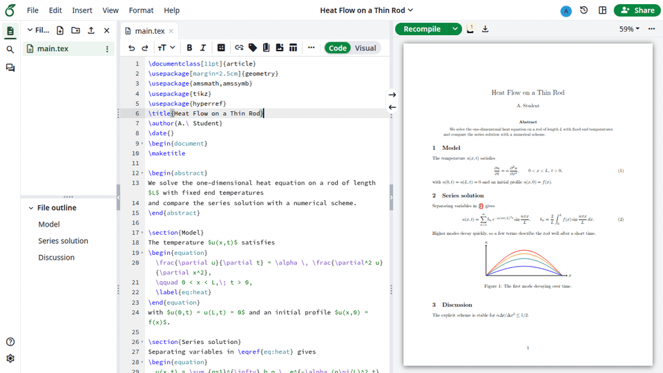
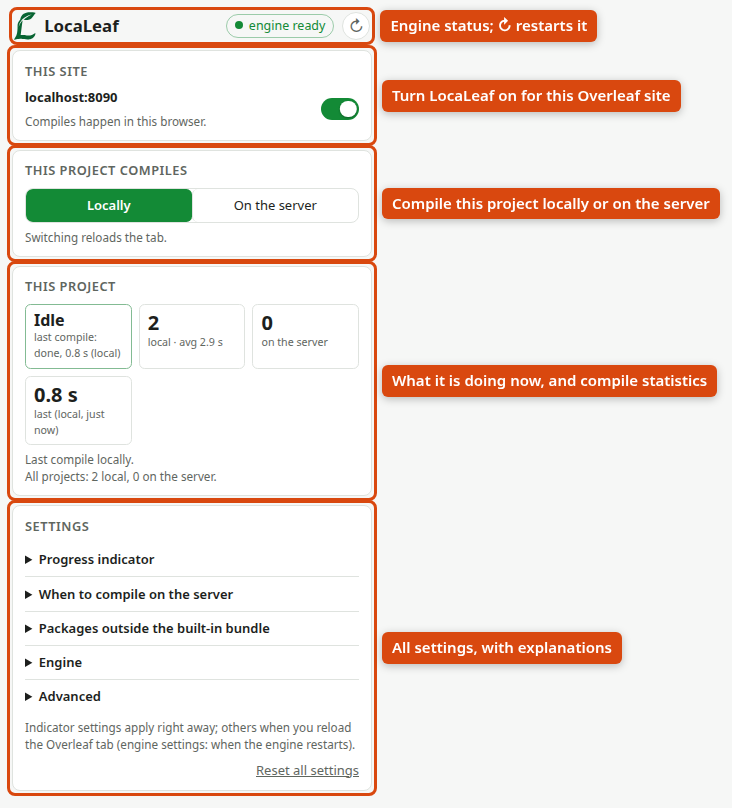
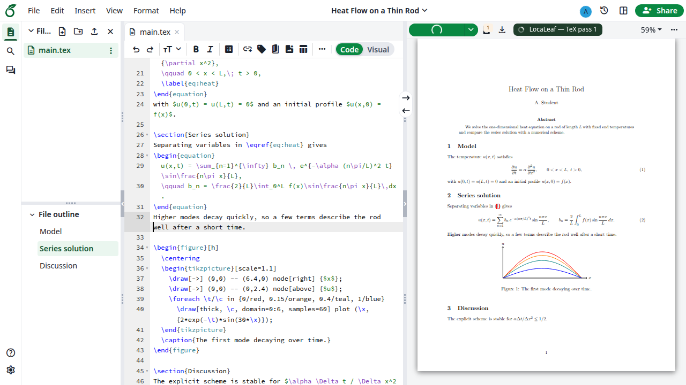
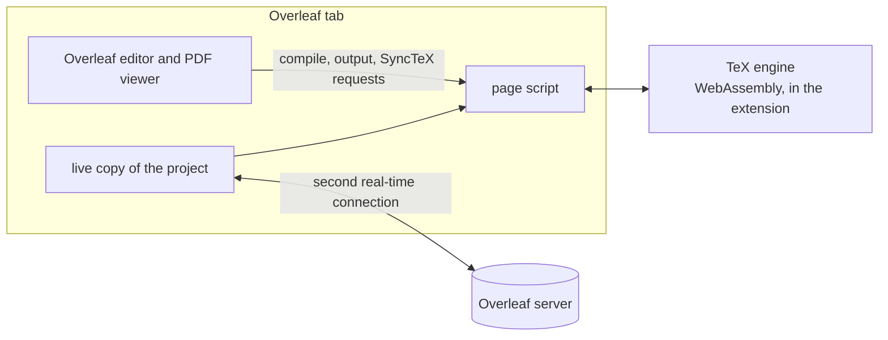

# LocaLeaf

A browser extension that compiles your Overleaf projects on your own computer instead of on the Overleaf
server. You keep editing in Overleaf as usual, collaborators included, and the PDF appears in Overleaf's own
preview. No TeX installation needed: TeX Live 2026 runs inside the extension as WebAssembly.



> [!NOTE]
> **AI notice:** this project was written largely with generative AI (Anthropic Claude). The code has not
> been reviewed line by line by a human, and it runs inside your logged-in Overleaf page. See
> [docs/AI_DISCLOSURE.md](docs/AI_DISCLOSURE.md) for what that means.

## Install

1. Download `localeaf-<version>.zip` (about 190 MB) from the
   [latest release](https://github.com/Delici0u-s/locaLeaf/releases/latest) and unzip it into a new, empty
   folder that you keep.
2. Open your browser's extension page (`chrome://extensions`, `brave://extensions`, `edge://extensions`) and
   turn on **Developer mode**.
3. Click **Load unpacked** and choose that folder.

**Updating:** replace the files in the same folder, then click the reload button on LocaLeaf's card on the
extension page. Keep the folder: a new folder counts as a new extension and starts without your settings and
caches.

## Getting started

1. Open a project in Overleaf.
2. Click the LocaLeaf icon (pin it via the puzzle-piece menu) and turn on the switch under **This site**. If
   the browser asks for access to your Overleaf site and to `ftp.fau.de` (the CTAN mirror for extra TeX
   packages), allow it. The page reloads.
3. Compile as usual.



While a compile runs, a small indicator next to Overleaf's download button shows what it is doing:



**Toolbar badge:** **…** while a project loads, **TeX** while it compiles locally, **SRV** while the server
compiles. Hover over the icon to see what is happening.

**The first compile** in a tab takes a few seconds longer while the engine starts. If it takes more than 2 s,
your server compiles too, and the first PDF wins. A project you haven't changed shows its last PDF right
away.

**Per project** you can choose *Locally* or *On the server* in the popup.

**Brave** sometimes never shows the permission prompt, and the switch turns itself off again. Then the only
way is to build from source with `"anySite": true` or your site in `"sites"` (see
[Building from source](#building-from-source)).

## What works

Everything around compiling works as before:

- Recompile, auto-compile, Stop, the compiler, draft mode and "stop on first error"
- the log pane and error markers in the editor
- SyncTeX: double-click jumps between the source and the PDF in both directions
- the download button
- BibTeX, Biber and makeindex

If a project needs something the local engine can't do, it compiles on the server instead, and a notice says
why. See [Limitations](#limitations).

**Speed:** after a one-line edit, a short article shows its new PDF in under half a second, a beamer talk or
a thesis in about 3 s, and a 200-page book in 6–7 s. That is close to native TeX Live on the same computer,
so it helps most when your server is slow or busy. Measurements: [docs/BENCHMARKS.md](docs/BENCHMARKS.md).

**Tested with:** Overleaf Community Edition and overleaf.com, in Brave (Linux), Chrome and Edge (Windows 11).
It should work in any Chromium-based browser from version 120.

**Needs:** about 260 MB of disk space, and a few hundred MB of memory while compiling. The engine closes
itself after 15 minutes without use.

## Privacy and network

Your documents stay in your browser. LocaLeaf talks to your Overleaf server like a second editor tab. The
only other traffic fetches TeX packages and fonts that aren't in the bundled TeX Live "recommended"
collection, once each, then cached:

1. from TeXlyre's TeX Live file server. The request contains only the file name, e.g. `IEEEtran.cls`;
2. if that server doesn't have it, the whole TeX Live package from a CTAN mirror.

To stay offline, open the popup's settings under **Packages outside the built-in bundle**, clear
**Package server** and turn off **Download whole TeX Live packages from CTAN**. Projects that need more than
the bundle then compile on your server.

## Settings

All settings are in the popup, grouped, with a short explanation each. Defaults and full descriptions are in
[config/settings.defaults.json](config/settings.defaults.json).

## Limitations

- **Compiled on the server instead** (with a notice): documents that need shell escape (`minted`, `svg`,
  `gnuplot`), the `latex` (DVI) compiler, and packages or fonts that aren't in TeX Live.
- **Not supported:** `makeglossaries`. A glossary stays empty in the local PDF; switch such a project to
  *On the server* in the popup.
- **First compile with new fonts:** XeLaTeX and LuaLaTeX need 15–30 s the first time they use fonts outside
  the bundle. For XeLaTeX this happens once per browser session.
- **Biber:** with non-ASCII names, `style=alphabetic` labels can come out garbled (a bug in the WebAssembly
  build of Biber).
- **TeX Live version:** if your server uses a TeX Live other than 2026, a notice says the output can differ
  slightly.
- **Online users:** you appear twice in Overleaf's list of online users, because of LocaLeaf's second
  connection.
- **Overleaf updates:** LocaLeaf relies on Overleaf's internal requests, which can change with any Overleaf
  version. If LocaLeaf itself fails (not a LaTeX error in your document), it compiles on the server instead.

## How it works



- LocaLeaf keeps a live copy of the project by following every edit over its own real-time connection, so a
  compile needs no request to the server.
- When Overleaf asks its server to compile, LocaLeaf answers instead. The engine reruns TeX, BibTeX and so on
  only as often as needed, like `latexmk`.
- The answer has the same shape as the server's, so Overleaf shows the PDF, log and errors as usual.

The original design and research notes: [docs/DESIGN.md](docs/DESIGN.md).

## Building from source

Needs Node.js 20+, `zip` and ImageMagick (`magick`).

```sh
npm install
npm run assets      # downloads the TeX engine and TeX Live bundle (~500 MB, once) into vendor/
npm run build       # → dist/, load it with "Load unpacked"
npm run package     # → release/localeaf-<version>.zip
```

An optional `localeaf.local.json` (git-ignored) changes the build:

```json
{ "sites": ["https://overleaf.example.com"], "anySite": true }
```

`sites` enables LocaLeaf on those Overleaf servers from the start. `anySite` grants access to all sites when
the extension loads, so turning on a site in the popup never needs a permission prompt. LocaLeaf still only runs on
sites you enable. `npm run package` ignores this file.

## Development

The tests run against a local Overleaf Community Edition in Docker:

```sh
npm install && npm run assets                           # as in "Building from source"
echo "OLR_DEV_INVITE_TOKEN_SECRET=$(openssl rand -base64 32)" > dev/overleaf-ce/.env   # once
docker compose -f dev/overleaf-ce/compose.yml up -d     # see dev/overleaf-ce/README.md
npm run test:all                                        # typecheck, unit, engine and end-to-end tests
```

`npm run test:all` takes about 30 minutes. Single suites are listed in `package.json`. Every test has a hard
deadline; on a failure, screenshots and console logs go to `test/.artifacts/`. The tests use Brave if it is
installed (`OLR_TEST_BROWSER` overrides it, `OLR_TEST_HEADED=1` shows the window). In the browser console,
`__localeaf.lastCompile()` shows the last local compile's status and log.

Open items: [docs/TODO.md](docs/TODO.md). Changes per version: [docs/CHANGELOG.md](docs/CHANGELOG.md).
The README visuals are recorded with `node dev/media/record.mjs`.

## Credits

- [texlyre-busytex](https://github.com/TeXlyre/texlyre-busytex): TeX Live compiled to WebAssembly, and
  TeXlyre's TeX Live file server.
- [TeX Live](https://tug.org/texlive/) and [CTAN](https://ctan.org/).
- [Local Compile for Overleaf](https://github.com/DominikPeters/local-compile-for-overleaf) by Dominik Peters,
  an earlier extension with the same idea (compiling with a native TeX through a local helper).
- [Overleaf](https://github.com/overleaf/overleaf). LocaLeaf is not affiliated with or endorsed by Overleaf.

Third-party licenses: [docs/THIRD_PARTY.md](docs/THIRD_PARTY.md).

## License

[AGPL-3.0-only](LICENSE), because it includes texlyre-busytex (AGPL-3.0).
