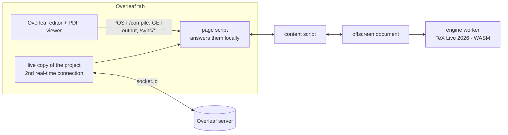

# Overleaf local render

A Chrome/Brave extension that compiles your Overleaf projects **on your own machine** and shows
the result in Overleaf's normal PDF preview. Useful when the Overleaf server is slow. You still edit
in Overleaf as usual, collaborators included. Recompile, auto-compile, the log pane, error
markers in the editor, SyncTeX (double-click jumps both ways) and the download button work as before.
The only difference is that the PDF comes from your machine.

TeX runs **inside the extension** as WebAssembly (TeX Live 2026 via
[texlyre-busytex](https://github.com/TeXlyre/texlyre-busytex)), so nothing else needs to be installed.
It is built and tested against Overleaf **Community Edition**.

> [!NOTE]
> Status: working prototype. See `PLAN.md` for the design and `bench/RESULTS.md` for measurements.

## Install (from source)

```sh
npm install
npm run assets      # downloads the TeX engine + TeX Live bundle (~500 MB, once) into vendor/
npm run build       # → dist/
```

Then open `brave://extensions` (or `chrome://extensions`), turn on **Developer mode** and use
**Load unpacked** on the `dist/` folder.

## Use

1. Open a project on your Overleaf server.
2. Click the extension icon → **Enable on this site** (your browser asks for access to that site).
   The page reloads.
3. Compile as usual. The badge shows **L** when the last compile ran locally and **S** when it fell
   back to the server. In that case a notice in the page says why.

Per project you can switch between compiling *locally* and *on the server* in the popup.
The first compile after opening a project takes a few seconds longer, because the extension
loads the whole project and starts the engine. After that, recompiles only process what changed.

## How it works



- **Project files:** the page script opens its own real-time connection (like a second tab),
  joins every document and applies every edit as it arrives, including collaborators' edits in files
  you don't have open. Images and other files are downloaded once and cached by content hash.
  A compile therefore makes **no request to the server**.
- **Compile:** Overleaf's `POST /project/:id/compile` is answered by the extension. The engine keeps
  each project's files between compiles and runs TeX like `latexmk`: it reruns only while `.aux`, `.toc`,
  `.bbl`, … still change, and runs bibtex/biber/makeindex only when their inputs changed. It uses the
  same options as Overleaf's compile server: main document, compiler, draft mode, stop on first error,
  `-jobname=output`, and continuing past errors.
- **Display:** the reply has the shape of Overleaf's own compile response. It points at the local
  output files, which the page script serves from memory (with range requests for pdf.js).

## Settings

The popup lists every setting with its current value. Defaults live in
`config/settings.defaults.json`, and each setting is documented there.

| Setting | Default | What it does |
|---|---|---|
| `remoteEndpoint` | TeXlyre's TeX Live 2026 server | Where packages outside the built-in bundle are fetched from (only file names are sent) |
| `engine.maxPasses` | 5 | TeX passes per compile at most |
| `engine.biberArgs` | `--output-safechars` | Works around an encoding bug in the WASM biber |
| `engine.maxProjects` | 4 | Projects kept in engine memory |
| `engineIdleMinutes` | 15 | Close the engine when unused (frees memory) |
| `fallbackToServer` | true | Compile on the server if a local compile can't run |
| `serverOnMissingFonts` | true | Compile on the server if fonts can't be provided locally |

## Limitations

- **Fonts picked by family name** in XeLaTeX/LuaLaTeX (`\setmainfont{Fira Sans}`): fonts outside the built-in
  bundle are looked up in an index of TeX Live's fonts and fetched from `remoteEndpoint`. The first compile per
  browser session then takes 15–30 s, because the engine scans and converts the fonts. If the package server
  doesn't have a font (e.g. Source Sans 3, Roboto), the project is compiled **on the server** instead
  (`serverOnMissingFonts`), with a notice saying which fonts are missing.
- **biber:** with non-ASCII names, alphabetic labels (`style=alphabetic`) can come out garbled
  (an upstream WASM biber bug). Everything else is fine with the default `--output-safechars`.
- **Not supported locally** (compiles on the server instead): the `latex` (DVI) compiler, `-shell-escape`
  packages like `minted`, and `makeglossaries`.
- The first time each package outside the bundle is used, it is downloaded from `remoteEndpoint`.
  Some packages are missing there (for example `kaobook`).
- You show up twice in the "online users" list, because the extension's connection counts as a second tab.

## Development

```sh
docker compose -f dev/overleaf-ce/compose.yml up -d     # local Overleaf CE, see dev/overleaf-ce/README.md
OLR_DEV_ORIGINS=http://localhost:8090 npm run build     # also injects into that origin without the popup
npm run typecheck
npm run test:unit                                       # OT, SyncTeX, rerun logic
npm run test:engine                                     # TeX engine in a real browser
npm run test:e2e                                        # extension + local Overleaf, in Brave
npm run test:e2e:extremes                               # 1000 files, 30 MB of images, umlauts, renaming
npm run test:e2e:fixtures                               # bigger public projects end to end
npm run test:all                                        # everything above, in order
```

Tests launch Brave if it's installed (`OLR_TEST_BROWSER` overrides it, and `OLR_TEST_HEADED=1` shows the window).
Each test script prints timestamped progress and has a hard deadline plus per-step time limits
(`config/test.json`; override with `OLR_TEST_DEADLINE_MS` / `OLR_TEST_STEP_MS`). When a check fails or a
deadline passes, screenshots and console logs of the open pages are saved to `test/.artifacts/`, and the script
exits (code 124 on a deadline). In the browser console, `__overleafLocalRender.lastCompile()` shows the last
local compile's status and log.

## License

AGPL-3.0, because it bundles texlyre-busytex (AGPL-3.0).
