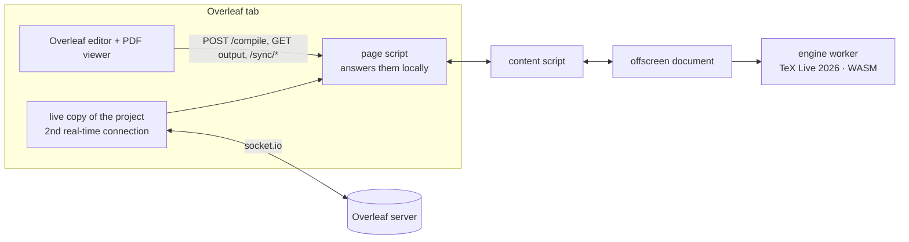

# LocaLeaf

A Chrome/Brave extension that compiles your Overleaf projects **on your own machine** and shows
the result in Overleaf's normal PDF preview. Useful when the Overleaf server is slow. You still edit
in Overleaf as usual, collaborators included. Recompile, auto-compile, the log pane, error
markers in the editor, SyncTeX (double-click jumps both ways) and the download button work as before.
The only difference is that the PDF comes from your machine.

TeX runs **inside the extension** as WebAssembly (TeX Live 2026 via
[texlyre-busytex](https://github.com/TeXlyre/texlyre-busytex)), so nothing else needs to be installed.
It is built and tested against Overleaf **Community Edition**.

> [!NOTE]
> Status: working prototype. See `PLAN.md` for the design and `bench/RESULTS.md` for measurements.

## Install (from source)

Needs Node.js 20+ and ImageMagick (`magick`, for the icons).

```sh
npm install
npm run assets      # downloads the TeX engine + TeX Live bundle (~500 MB, once) into vendor/
npm run build       # → dist/
```

**Your Overleaf address (recommended):** put it in `localeaf.local.json` before building. LocaLeaf is then enabled
there from the start, and the browser never has to show a permission prompt (Brave sometimes doesn't):

```json
{ "sites": ["https://overleaf.example.com"] }
```

Or let the popup's **Enable on this site** work without any prompt, on whatever site you're on:

```json
{ "anySite": true }
```

This grants site access for all sites when the extension loads, but LocaLeaf still only runs on the sites
you enable in the popup. Without the file, the popup asks the browser for access, which some Brave setups
never show.

Then in Brave (Chrome works the same way, under `chrome://extensions`):

1. Open `brave://extensions`.
2. Turn on **Developer mode** (top right).
3. Click **Load unpacked** and choose the `dist/` folder.
4. Optional: pin LocaLeaf in the toolbar (puzzle icon → pin), so you see its badge.

**On another machine without Node.js:** `npm run package` makes `release/localeaf-<version>.zip` (no personal
`localeaf.local.json` in it). Unzip it there and use **Load unpacked** on the unzipped folder.

**Updating:** run `npm run build` again, then click the reload arrow on LocaLeaf's card in `brave://extensions`,
and reload the Overleaf tab.

## Use

1. Open a project on your Overleaf server.
2. Click the extension icon → **Enable on this site**. Your browser asks for access to that site and to
   the CTAN mirror (used for TeX Live packages the extension doesn't ship). The page reloads.
3. Compile as usual. The badge shows **L** when the last compile ran locally and **S** when it fell
   back to the server. In that case a notice in the page says why.

Per project you can switch between compiling *locally* and *on the server* in the popup.
The first compile after opening a project takes a few seconds longer, because the extension loads the whole
project and starts the engine. LocaLeaf keeps each project's last build, so even that first compile only redoes
what changed since last time, and a project you didn't change shows its PDF right away.
While a tab is still warming up (engine starting, first build of a project, packages or fonts downloading), a
local compile that isn't done after 2 s is also sent to the server, and whichever PDF comes first is shown. The
local compile keeps going in the background; after it, compiles in that tab are local only
(`raceWhileCold`, `raceHeadStartMs`).

## What goes over the network

Compiling is local: your documents never leave the browser except to your Overleaf server, exactly as before.
The extension ships TeX Live 2026's "recommended" collection (~200 MB). A document that needs a package or font
outside it gets that **file** downloaded once and cached:

1. from `remoteEndpoint` (TeXlyre's TeX Live 2026 file server). The request contains only the file name, e.g.
   `26/IEEEtran.cls`.
2. if that server doesn't have it, from `ctanMirror`, which serves the whole TeX Live package (e.g. `gradbars.tar.xz`).

To keep everything on your machine: set `remoteEndpoint` to empty and `engine.fetchFromCtan` to off in the popup.
Projects that need something outside the bundle then compile on your Overleaf server instead. To need fewer
downloads, add `"texlive-extra"` to `bundles` in `config/engine.json` (+340 MB) and rebuild.

## How it works



- **Project files:** the page script opens its own real-time connection (like a second tab),
  joins every document and applies every edit as it arrives, including collaborators' edits in files
  you don't have open. Images and other files are downloaded once and cached by content hash.
  A compile therefore makes **no request to the server**.
- **Compile:** Overleaf's `POST /project/:id/compile` is answered by the extension. The engine keeps
  each project's files between compiles and runs TeX like `latexmk`: it reruns only while `.aux`, `.toc`,
  `.bbl`, … still change, and runs bibtex/biber/makeindex only when their inputs changed. It uses the
  same options as Overleaf's compile server: main document, compiler, draft mode, stop on first error,
  `-jobname=output`, and continuing past errors.
- **Display:** the reply has the shape of Overleaf's own compile response. It points at the local
  output files, which the page script serves from memory (with range requests for pdf.js).

## Settings

The popup lists every setting with its current value. Defaults live in
`config/settings.defaults.json`, and each setting is documented there.

| Setting | Default | What it does |
|---|---|---|
| `remoteEndpoint` | TeXlyre's TeX Live 2026 server | Where packages outside the built-in bundle are fetched from (only file names are sent) |
| `ctanMirror` | `https://ftp.fau.de/ctan` | CTAN mirror for TeX Live packages `remoteEndpoint` lacks (whole package archives, cached) |
| `engine.maxPasses` | 5 | TeX passes per compile at most |
| `engine.biberArgs` | `--output-safechars` | Works around an encoding bug in the WASM biber |
| `engine.maxProjects` | 4 | Projects kept in engine memory |
| `engine.persistCacheMB` | 300 | Converted fonts and downloaded files kept across engine restarts (faster first compile) |
| `engine.persistBuildMB` | 40 | Per project: last build kept across restarts; first compile is incremental, or instant if nothing changed |
| `engineIdleMinutes` | 15 | Close the engine when unused (frees memory) |
| `fallbackToServer` | true | Compile on the server if a local compile can't run |
| `serverOnMissingFonts` | true | Compile on the server if fonts can't be provided locally |
| `serverOnMissingPackages` | true | Compile on the server if TeX Live packages can't be provided locally |
| `raceWhileCold` | true | Until a tab's first local compile is done, the server compiles too and the first PDF wins |
| `raceHeadStartMs` | 2000 | How long the local compile runs alone before the server joins the race |

## Limitations

- **Packages and fonts outside the built-in bundle** are fetched on first use: from `remoteEndpoint`, and if
  that doesn't have them (~8% of TeX Live), as their TeX Live package from the CTAN mirror (`ctanMirror`).
  Both are cached, also across browser restarts. Fonts picked by family name (`\setmainfont{Source Sans 3}`) are found through an index of
  TeX Live's fonts. The first compile that needs new fonts takes 15–30 s, because the engine scans and
  converts them.
- What can't be provided locally at all (e.g. `kaobook`, which isn't in TeX Live) makes the project compile
  **on the server** instead (`serverOnMissingPackages` / `serverOnMissingFonts`), with a notice saying what was missing.
- **biber:** with non-ASCII names, alphabetic labels (`style=alphabetic`) can come out garbled
  (an upstream WASM biber bug). Everything else is fine with the default `--output-safechars`.
- **Not supported locally** (compiles on the server instead): the `latex` (DVI) compiler, `-shell-escape`
  packages like `minted`, and `makeglossaries`.
- A missing file of your own (a typo in `\input`) doesn't trigger the server fallback, because the server
  would fail on it too.
- If the project's TeX Live image on the server isn't TeX Live 2026, a notice says the output can differ slightly.
- You show up twice in the "online users" list, because the extension's connection counts as a second tab.

## Development

```sh
docker compose -f dev/overleaf-ce/compose.yml up -d     # local Overleaf CE, see dev/overleaf-ce/README.md
npm run build:test                                      # → dist-test/, also injects into the dev Overleaf (no popup)
npm run typecheck
npm run test:unit                                       # OT, SyncTeX, rerun logic
npm run test:engine                                     # TeX engine in a real browser
npm run test:e2e                                        # extension + local Overleaf, in Brave
npm run test:e2e:history-ot                             # projects using Overleaf's newer history-ot documents
npm run test:e2e:extremes                               # 1000 files, 30 MB of images, umlauts, renaming
npm run test:e2e:fixtures                               # bigger public projects end to end
npm run test:all                                        # everything above, in order
```

Tests launch Brave if it's installed (`OLR_TEST_BROWSER` overrides it, and `OLR_TEST_HEADED=1` shows the window).
Each test script prints timestamped progress and has a hard deadline plus per-step time limits
(`config/test.json`; override with `OLR_TEST_DEADLINE_MS` / `OLR_TEST_STEP_MS`). When a check fails or a
deadline passes, screenshots and console logs of the open pages are saved to `test/.artifacts/`, and the script
exits (code 124 on a deadline). In the browser console, `__localeaf.lastCompile()` shows the last
local compile's status and log.

## License

AGPL-3.0, because it bundles texlyre-busytex (AGPL-3.0).
