# Benchmarks: WASM TeX vs native latexmk (2026-11-22)

> [!NOTE]
> Measured during the design phase, before most of LocaLeaf existed. Some problems found here are fixed since
> (the Biber encoding bug, fonts chosen by family name), and later features make recompiles faster (builds
> kept across restarts). For the current state see the [README](../README.md) and [CHANGELOG](CHANGELOG.md).

Machine: this laptop (Fedora 43). Browser: Brave 1.100 (headless, via Playwright).
WASM engine: texlyre-busytex 1.4.1 (TeX Live 2026), `texlive-recommended` bundle preloaded,
other packages on demand from `texlive2026.texlyre.org`. Native: `texlive/texlive:latest`
(TeX Live 2026) in a long-running Docker container, with Overleaf's exact CLSI latexmk flags.
Raw data: `bench/results/*.json`. Rerun in `bench/` with `npm run wasm` / `npm run native`.

**Steps:** *first* = cold compile of the project; *unchanged* = recompile with no change;
*edit* = recompile after a one-line change (median of 2 edits).

## Recompile after an edit (what you wait for while writing)

| Project | Engine | Native latexmk | WASM, busytex pipeline | **WASM, our rerun logic** |
|---|---|---|---|---|
| IEEE journal article | pdfLaTeX | 0.44 s | 0.91 s | **0.35 s** |
| Metropolis beamer talk (pgfplots, bibtex) | pdfLaTeX | 2.4–4.7 s | 9.9 s | **2.6 s** |
| cleanthesis (biber, ~10 chapters) | pdfLaTeX | 2.4 s | ✗ (see 3.) | **2.7 s** |
| lshort, 200-page book | XeLaTeX | 4.7–5.0 s | 27.4 s | **7.3 s** |
| Awesome-CV | LuaLaTeX | 10.8–11.0 s | ✗ fonts (see 4.) | ✗ fonts |

```mermaid
xychart-beta
    title "Recompile after an edit (seconds, lower is better)"
    x-axis ["IEEE", "Beamer", "Thesis", "lshort"]
    y-axis "seconds" 0 --> 28
    bar [0.44, 2.4, 2.4, 4.85]
    bar [0.91, 9.9, 13, 27.4]
    bar [0.35, 2.6, 2.7, 7.3]
```

*(bars per project: native, busytex pipeline, our rerun logic; "Thesis" pipeline = failed run time)*

## Other timings

| | Native | WASM |
|---|---|---|
| Engine start (once per browser session, from cache) | – | 2.9 s |
| Engine start, first ever (local copy of the 200 MB bundle) | – | 4.1 s + download time |
| First compile: IEEE / beamer / thesis / lshort | 0.8 / 7.1 / 11.3 / 21.7 s | 0.9 / 9.9 / 13.3 (✗) / 27.1 s |
| Recompile with no change | 0.17 s (latexmk skips) | 0.35–7 s (our logic still runs one pass; skipping by content hash is trivial) |

## Findings

1. **WASM is fast enough when we control reruns.** busytex's own pipeline always runs ≥ 3 TeX passes
   (first + check + separate final pass) on a fresh filesystem, so it is 2–6× slower than native.
   Keeping the generated files (`.aux`, `.toc`, `.bbl`, …) between compiles and rerunning only while
   they change (like latexmk) brings pdfLaTeX to **native speed** and XeLaTeX to ~1.5× native.
2. **We need our own pipeline file.** `busytex_pipeline.js` (plain JS in the assets) hard-codes
   `--halt-on-error`. Overleaf's default is `-f` (continue past errors), so documents with small errors
   give *no PDF* in WASM but a PDF on Overleaf. Our fork: no halt by default, `-halt-on-error` only for
   "stop on first error", plus the rerun logic above.
3. **WASM biber has a correctness bug:** for cleanthesis it produces a `.bbl` with `U+0088`, which
   LaTeX rejects. Native biber doesn't. Needs investigation or an upstream issue (bibtex8 path is fine).
4. **LuaLaTeX/XeLaTeX fonts by family name** (`\setmainfont{Source Sans 3}`) fail if the font isn't
   in the preloaded bundle: the on-demand server serves *files*, while fontspec looks up *families*.
   Fix options: preload a font bundle, or map family → file names using TeX Live's font metadata.
5. **On-demand package server is incomplete** (`kaobook.cls` 404). An extension can fetch from any
   TeX Live/CTAN mirror itself (host permissions bypass CORS), so it doesn't depend on that server.
6. kaobook's own examples are broken with TeX Live 2026 (also natively), so they were dropped.

## Still missing: your server

To make the decision on real numbers: upload the projects in `bench/fixtures/` (zip each folder) to your
Overleaf, set the compiler from `bench/fixtures.json`, and time Recompile after a one-line edit.
